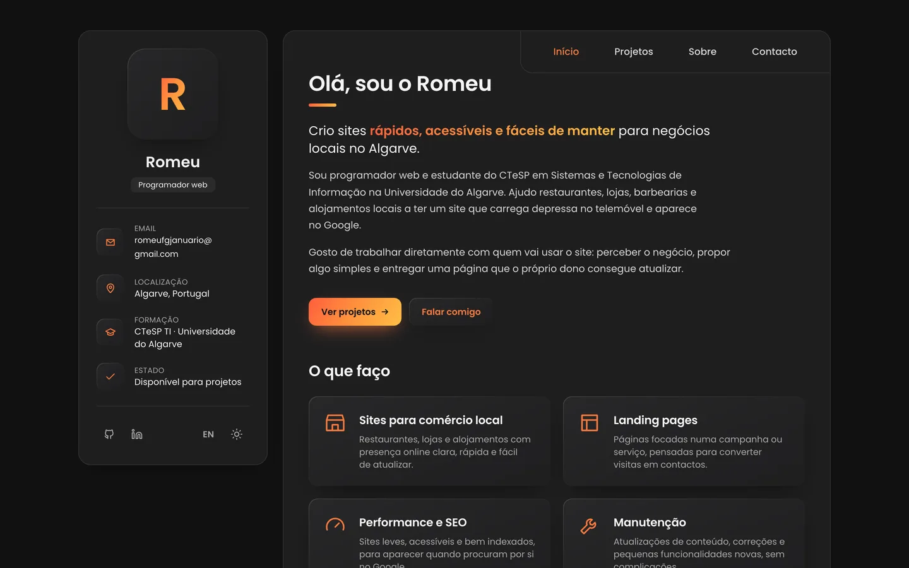

# Romeu · Web developer portfolio

Personal portfolio of Romeu, a web developer based in the Algarve, Portugal, and a student of Information Systems and Technologies (CTeSP) at the University of the Algarve. It showcases websites for local businesses, course projects and personal tools, in Portuguese and English.

**Live site:** https://romeu-portfolio.vercel.app



## Features

- Projects written as Markdown files in an Astro content collection, validated with a Zod schema
- Project list with a technology filter in plain JavaScript (state kept in the URL)
- Project pages with an image gallery and lightbox, a stack, and GitHub/demo links
- Portuguese (`/`) and English (`/en/`) versions with translated URLs and `hreflang`
- Dark theme by default, with a light theme saved in `localStorage`
- Contact form via Formspree, with client-side validation
- SEO: meta tags, Open Graph, sitemap, `robots.txt` and `Person` JSON-LD
- Static project demos served from the same deploy (`/demos/...`)
- Lighthouse 99–100 in every category, on mobile and desktop

## Stack

| | |
|---|---|
| Framework | [Astro 7](https://astro.build) (static output) |
| Styling | [Tailwind CSS 4](https://tailwindcss.com) with CSS custom properties |
| Content | Astro content collections + Zod |
| Language | TypeScript |
| Fonts | Poppins and JetBrains Mono, self-hosted via Fontsource |
| Forms | [Formspree](https://formspree.io) |
| Hosting | [Vercel](https://vercel.com) |

## Run locally

Requires Node.js 22.23 or later.

```bash
npm install
cp .env.example .env   # then fill in the values
npm run dev            # http://localhost:4321
```

| Command | What it does |
|---|---|
| `npm run dev` | Development server with hot reload |
| `npm run build` | Builds the static site into `dist/` |
| `npm run preview` | Serves `dist/` locally |
| `npm run check` | Type-checks the project (`astro check`) |
| `npm run sync:demos` | Copies the Maré Alta demo from `../mare-alta` into `public/demos/` |

### Environment variables

| Variable | Required | Description |
|---|---|---|
| `PUBLIC_FORMSPREE_ID` | No | Formspree form ID (`https://formspree.io/f/<ID>`). Without it the form is disabled and shows a notice. |
| `SITE_URL` | No | Public URL used for the sitemap, canonical URLs and Open Graph. On Vercel it falls back to the production domain. |

## Add a new project

Adding a project only takes one Markdown file. No code changes needed.

1. Create `src/content/projects/<slug>.md`. The file name becomes the URL (`/projetos/<slug>/`).

   ```markdown
   ---
   title: Project name
   summary: One or two sentences (max. 220 characters).
   stack: [Astro, Tailwind CSS]
   category: comercio-local      # comercio-local | profissional | academico | pessoal
   repoUrl: https://github.com/RFJ26/my-project   # optional
   liveUrl: https://my-project.vercel.app         # optional; can also be /demos/<name>/
   cover: ../../assets/projects/<slug>/cover.webp
   coverAlt: What the cover image shows
   gallery:                      # optional
     - src: ../../assets/projects/<slug>/galeria-1.webp
       alt: What this image shows
   featured: true                # shown on the home page (latest 3)
   date: 2026-11-18
   ---

   ## The challenge
   Write the project story here, in Markdown.
   ```

2. Put the images in `src/assets/projects/<slug>/`. Astro resizes and optimises them at build time.
3. *(Optional)* For the English version, create `src/content/projects/en/<slug>.md` with only `title`, `summary`, `coverAlt`, `galleryAlts` and the body text. If it doesn't exist, the English page shows the Portuguese text with a notice.

If a required field is missing or has the wrong type, `npm run build` stops with a clear error.

### Static demos

Static sites (HTML, CSS and JavaScript) can be served by the portfolio itself from `public/demos/<name>/`, using `liveUrl: /demos/<name>/`. The Maré Alta demo lives in its own repository next to this one; after changing it, run `npm run sync:demos` and commit.

## Project structure

```
src/
├── content/projects/      # one .md per project (+ en/ for translations)
├── content.config.ts      # collection schema
├── assets/projects/       # project images
├── components/            # layout (sidebar, navbar), UI, home, projects, contact, SEO
├── views/                 # page bodies shared by both languages
├── pages/                 # routes (Portuguese) and pages/en/ (English)
├── i18n/                  # UI strings, categories, URL translation
├── data/                  # site details and services
└── styles/global.css      # Tailwind, colour tokens, components
public/demos/              # static project demos
```

## Deploy

The site deploys to Vercel from the `main` branch. `vercel.json` sets long-term caching for hashed assets and a few security headers. See [docs/deploy.md](docs/deploy.md) for the full steps, including connecting a custom domain.

## Credits

Layout inspired by the [vCard](https://github.com/codewithsadee/vcard-personal-portfolio) template by codewithsadee (MIT), rebuilt in Astro and Tailwind with a different colour palette.
